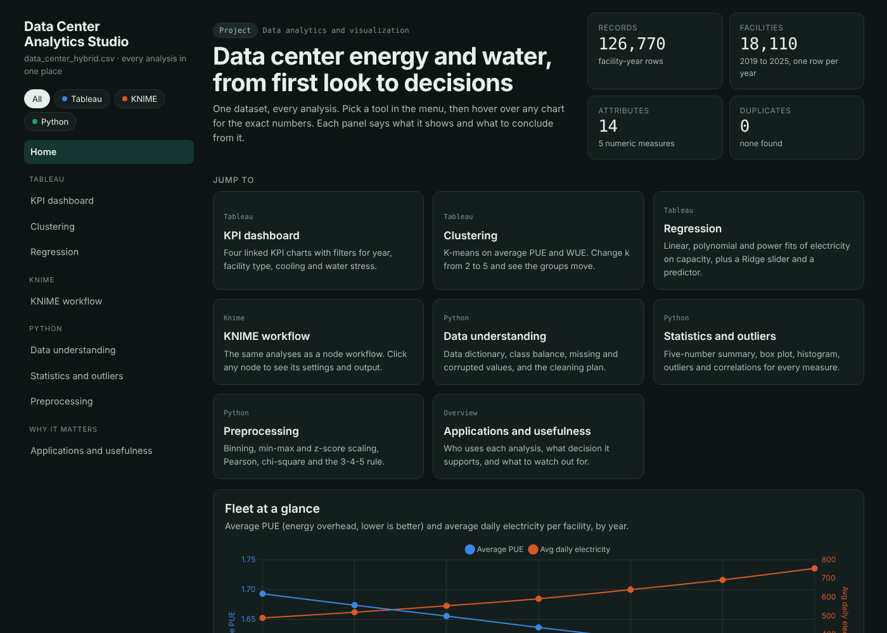
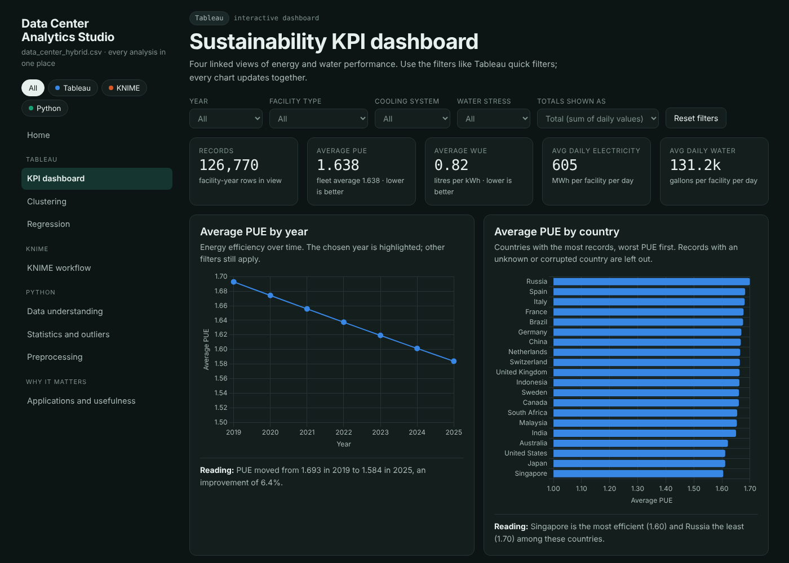
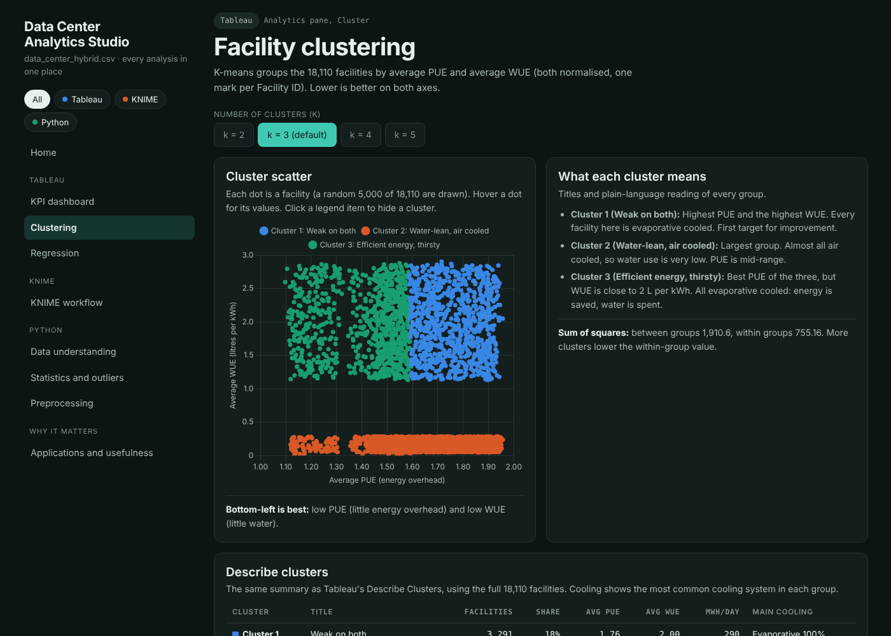
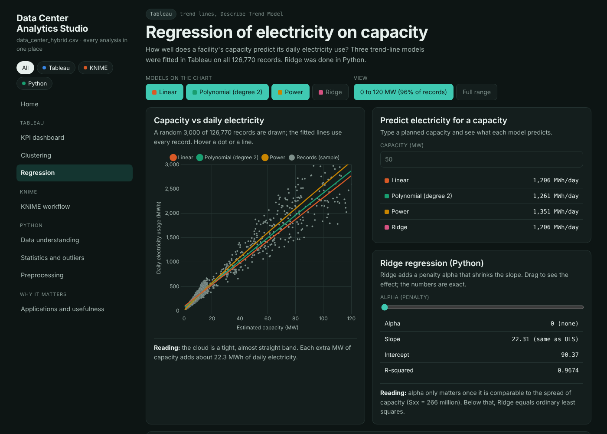

# Data Center Analytics Studio

**Live demo:** https://rajvyas044.github.io/dav-data-center-analytics/webapp/index.html

A web app that shows all the analysis of `data_center_hybrid.csv`
(126,770 records, 18,110 facilities, 2019 to 2025) in one place:
KPI dashboard, clustering, regression, KNIME workflow view,
statistics, preprocessing and applications.

## Screenshots

## Tools used

- **Python** (pandas, NumPy, SciPy): data cleaning, statistics, preprocessing, Ridge regression
- **Tableau**: KPI dashboard, clustering, trend lines
- **KNIME**: workflow view of the same analyses
- **Chart.js, HTML, CSS, JavaScript**: the web app
- **GitHub Pages**: hosting

## Open the web app

Open `webapp/index.html` with Live Server, or double-click it.

## Run the Python code

1. `python -m venv .venv`
2. `.venv\Scripts\activate`
3. `pip install -r requirements.txt`
4. Open a file in `practicals/` and press Run.

## Folders

- `data/raw`: the dataset
- `practicals`: Python analysis code
- `tableau`: Tableau workbooks
- `webapp`: the project web app